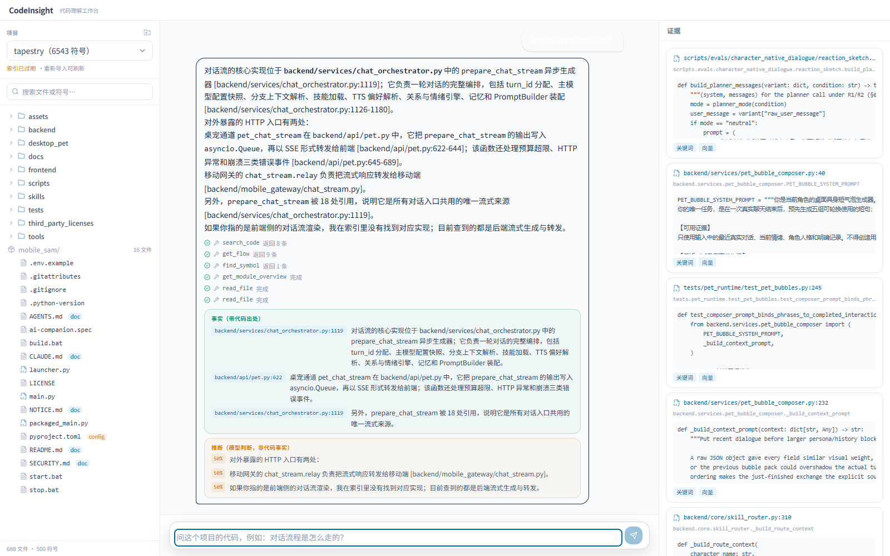
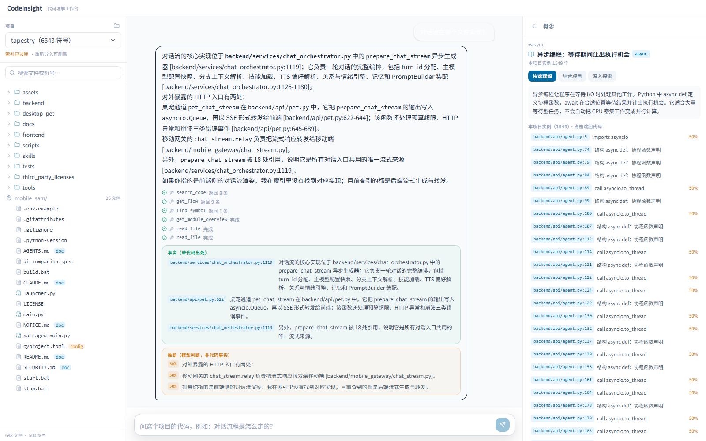
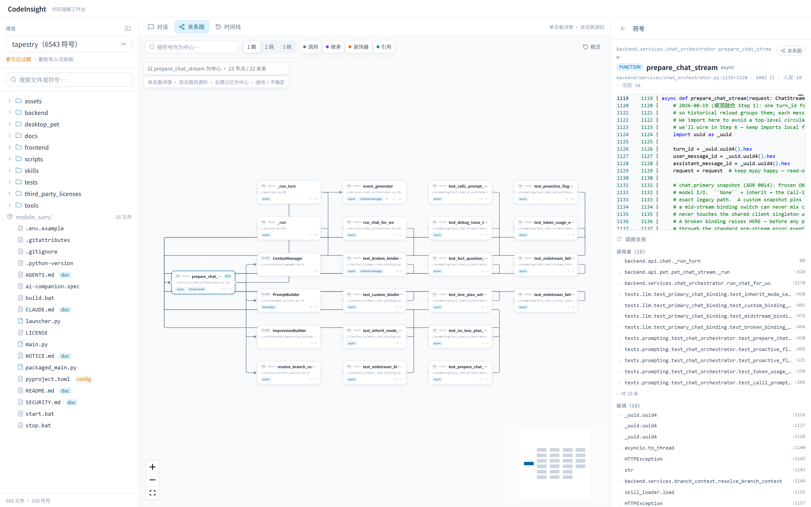
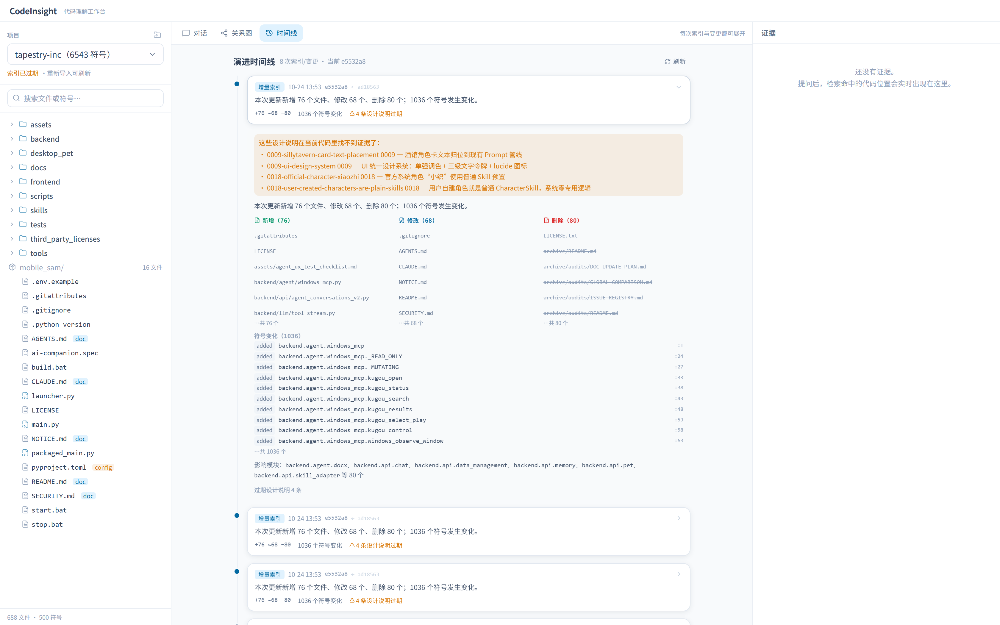

# CodeInsight

> **基于持续项目认知的智能代码理解与知识探索 Agent**

导入一个真实项目，围绕「这段逻辑在哪、怎么串起来、为什么这么写」逐步探索。
普通问答默认阅读当前工作区，索引用于辅助定位、静态关系和版本演进。
回答连贯解释问题，关键来源可以打开；资料缺口在相关段落说明，不编造实现或成绩。



<sub>早期工作台截图；当前左栏包含项目、对话与文件，中间为对话／关系图／时间线，右栏为可调整的多页签材料阅读器。来源与查阅过程按需打开。</sub>

---

## 它和「把代码丢给模型」有什么不同

1. **围绕问题建立理解。**
   先讲清模块解决什么问题、数据怎样流动、方案有什么代价。一般原理和类比不按引用有无拆成事实与推断。

2. **关键来源可以打开。**
   关键实现提供少量代码链接，完整位置与本轮查阅材料按需查看。
   位置对应不等于解释已经被证明；资料不足就在相关段落说明，不编造项目实现或成绩。
   旧字段保持兼容，行为约定见 [ADR 0040](docs/decisions/0040-understanding-first.md)。

3. **认知是持续的，不是一次性的快照。**
   新文件和未提交修改可直接阅读；更新索引时按文件变化和解析器版本复用或重算结构，
   能报出「这次改了什么、影响谁、哪条设计说明已经过期」（[ADR 0016](docs/decisions/0016-design-staleness-by-evidence-loss.md)）。

4. **检索是结构化的。**
   BM25 / 稠密 / 符号关系 / 概念实例四路通道，通道开关就是实验的臂——
   没有需要拍脑袋的融合权重（[评测](#评测)）。

5. **关系和演进都能看见。**
   以任意符号为中心拉出 N 跳调用/继承/引用图，节点上挂**概念标签**；
   单击看详情、双击跳到源码。另一屏是索引与变更的时间线：
   每次改了什么、影响了谁、哪条设计说明失去了证据。

6. **按需编排外部执行器。**
   写代码、跑命令、跑测试交给外部 agent；CodeInsight 通过 **MCP** 把理解能力递过去，
   也能反过来编排 Claude Code／ZCode 完成开发任务（双重审批 + worktree 隔离，[ADR 0035](docs/decisions/0035-orchestrated-execution.md)），
   闭环四段（理解 / 操作 / 变更验证 / 认知更新）一段不丢。

## 数字

以下为早期固定版本的索引与性能记录：织忆（Tapestry，作者另一个项目）@
`agent-v1`（`e5532a84`），688 个文件 / 389 个 Python 模块。
复现命令见下文；当前解析器与流程规则已经更新，重跑结果可能不同，不能将旧数字当作新版实测。

| 指标 | 数值 | 怎么来的 |
|---|---|---|
| 符号 / 边 | 6543 个符号，43135 条边（12832 条解析到仓库内符号） | [SQL 可查](#复现) |
| 块 | 6400 块（超大符号按语句递归切分） | `chunk` 表 |
| 入口 / 流程 / 设计说明 / 概念 | 4 / 9 / 43 / 20（3605 处实例） | 各表 `COUNT(*)` |
| 全量索引 | 约 31 秒（含中文分词；不含 embedding） | `ci index` |
| 增量索引 | 40 个 commit → 1036 个符号变化，20.7 秒 | `ci index --incremental` |
| 关系图 | `prepare_chat_stream` 1 跳：23 节点 / 22 边，接口 0.27 秒 | `GET /projects/{id}/graph` |

最近一次已提交的工程回归（`54ab8e6`）：后端 **591 通过、1 项环境跳过**，
前端 Vitest **162 通过**、Playwright **67 通过**；Ruff、ESLint、构建通过。
这是既有[验收报告](docs/reports/2026-10-28-debug-core-consistency.md)的记录，
不代表实时测试状态或真实模型质量；该轮真实模型与外部执行器调用均为 0。

## 评测

以下保留早期报告的数据，未使用当前解析器重新评测。
同一批题（从索引自动生成，不手工标），只改检索通道开关：

| 臂 | 命中@8 | MRR | Top-1 |
|---|---|---|---|
| `none`（不检索） | 0% | 0.000 | 0% |
| `bm25` | 81% | 0.691 [0.581, 0.793] | 63% |
| `hybrid`（+ 稠密） | 89% | 0.729 [0.632, 0.819] | 63% |
| `symbol` | 42% | 0.288 [0.193, 0.392] | 19% |
| `concept` | 18% | 0.177 [0.081, 0.274] | 18% |
| **`full`（产品配置）** | **98%** | **0.823 [0.744, 0.895]** | **73%** |

n=62，k=8，seed=7，括号内为 95% bootstrap 区间。完整报告：
[`eval/reports/run-f97b4c0d1f33-s7/report.md`](eval/reports/run-f97b4c0d1f33-s7/report.md)。

**最重要的发现是「每个通道只在自己的题型上强」**：

| 题型 | 最强单通道 | 说明 |
|---|---|---|
| 知道名字找实现 | `symbol` 0.702 | 结构化索引的价值 |
| 只知道描述 | `bm25` 0.980 | 语义通道反而略降（0.940） |
| 用了哪个概念 | `concept` 0.917 | 词面检索只有 0.042 |

> 这些数字的边界写在报告里：题目自动生成、没有人工复核；n 小、区间宽；
> 臂间差值小于区间重叠时**不构成结论**。这里不放没测过的指标。

## 快速开始

需要 Python 3.13+ 与 [uv](https://astral.sh/uv/)；前端需要 Node 20+。

**Windows 双击启动**：运行根目录的 [`启动 CodeInsight.bat`](<启动 CodeInsight.bat>)。
推荐安装 Node.js 24 LTS；首次运行会准备缺少的 Python／前端依赖，需要网络。
前后端就绪后自动打开 `http://127.0.0.1:5173`。请保留启动窗口，按 **Ctrl+C** 停止本次
启动的服务。重复运行会复用匹配的已有服务；后端默认从 8020 选择可用端口，自动避开
其他程序并同步前端代理。显式指定 `--backend-port` 时严格使用指定端口，冲突会提示。
日志保存在 `.ci/launcher/`；模型配置仍读取根目录 `.env`，不配置密钥也能浏览教材与已有索引。
仅检查环境可运行 `"启动 CodeInsight.bat" --check`，不想自动打开浏览器可加 `--no-browser`。
项目目录搬迁后，在左栏提示处点击“重新定位”，选择新目录并重建索引；对话和工作记录保留，
失败时保留原索引。Windows 使用带地址栏和搜索的现代系统文件夹窗口。
导入受理后，顶部持续显示索引状态，完成后可查看文件；状态检查中断时可以继续检查，
不会重复导入。等待期间仍可浏览教材、写草稿或切换项目。

```bash
uv sync --extra dev

# 1) 索引一个仓库（缺 key 也能跑，只是没有语义检索）
uv run ci index --repo /path/to/repo --name demo --concepts knowledge/concepts

# 2) 命令行提问（需要 CI_LLM_API_KEY）
uv run ci ask "对话消息是怎么从 HTTP 入口流到前端的？" --project demo

# 3) 起后端（保持该终端运行）
uv run uvicorn codeinsight.api.app:app --port 8020
```

另开终端，从仓库根目录启动前端：

```bash
cd frontend
npm install
npm run dev    # 默认真实后端；http://localhost:5173
```

接到外部 agent（从仓库根目录执行，配置见 [`docs/mcp.md`](docs/mcp.md)）：

```bash
uv run ci mcp --project demo
```

配置只走环境变量（复制 `.env.example` 为 `.env`）：

| 变量 | 用途 |
|---|---|
| `CI_LLM_API_KEY` / `CI_LLM_BASE_URL` / `CI_LLM_MODEL` | 问答用的 OpenAI 兼容模型 |
| `CI_EMBEDDING_API_KEY` / `..._BASE_URL` / `..._MODEL` / `..._DIM` | 语义检索（缺省硅基流动 bge-m3） |

## 它长什么样



<sub>代码 → 概念：证据面板上的概念标签点进去，就是「这个项目里这个概念在哪、怎么用的」。</sub>



<sub>以 `prepare_chat_stream` 为中心的 1 跳邻域：节点带 kind、file:line 与概念标签
（async / context-manager / decorator / thread-pool）；单击看详情、双击跳到源码、
右键换中心。虚线 = 静态分析不确定的关系。</sub>



<sub>一次增量索引展开后：新增/修改/删除的文件、1036 个符号变化、影响模块，
以及**失去代码证据的 4 条设计说明**——这些数字都是索引当时写下的，读侧不重算。</sub>

## 架构

```
当前工作区 ──▶ 目录／文字搜索／读文件 ──▶ 按内容哈希保存来源
                         │                         │
Git 提交／非 Git 目录 ──▶ 隔离构建索引 ──▶ 短事务发布 SQLite
                         │                 （符号／边／块／概念）
                         │                         │
内置教材 ──▶ 按需读取 ──┴──▶ Agent ◀── 四路检索 + 静态关系
                               │
                               ├──▶ SSE ──▶ React 工作台
                               └──▶ MCP ──▶ 外部 agent
```

| 层 | 关键决定 |
|---|---|
| 当前文件 | 普通阅读与文字搜索直接访问项目工作区；新文件无需先提交或更新索引 |
| 索引扫描 | Git 项目用 `git ls-tree` 读取指定提交；非 Git 目录读取目录；该规则不限制当前文件阅读 |
| 索引发布 | 隔离 SQLite 副本中构建，短事务发布项目索引；不覆盖期间新增的对话、任务或其他项目数据 |
| 解析 | 标准库 `ast`；能唯一解析才连边，判不了就留空并标 `confidence<1` |
| 切块 | 符号是原子；超大符号按语句边界递归切分，`symbol_id` 不变 |
| 检索 | BM25(FTS5) + 稠密 + 符号关系 + 概念实例，RRF 融合（只看名次） |
| 回答 | 连贯解释；关键来源可定位；资料缺口具体说明 |
| 来源 | 点击优先打开记录的内容版本；主动“查看当前文件”重新读磁盘并从第 1 行打开 |
| 增量 | 只重算变了的文件；删除符号前快照调用者；设计说明按「证据消失」判过期 |

更细的决策见 [`docs/decisions/`](docs/decisions/)，接口约定见 [`docs/interfaces.md`](docs/interfaces.md)。

## 复现

```bash
# 索引规模
sqlite3 .ci/codeinsight.db "SELECT COUNT(*) FROM symbol;"
sqlite3 .ci/codeinsight.db "SELECT COUNT(*) FROM edge WHERE dst_symbol_id IS NOT NULL;"

# 检索对照（会写 eval/reports/<run_id>/）
uv run ci eval --project demo -n 25

# 增量索引（先提交一次改动）
uv run ci index --repo /path/to/repo --name demo --incremental
uv run ci changes --project demo
```

## 已知限制

- **结构化符号与调用解析目前只支持 Python**。其他文本文件仍可阅读与文字搜索；多语言教材不代表具备相应语言的 AST 解析器。
- **当前阅读与静态关系可能属于不同版本**。历史链接按已保存内容恢复；缺失来源版本的旧记录只提供主动查看当前文件，不套用旧行号。
- **索引构建需要临时磁盘空间**，最终发布仍有短写事务；不承诺零等待。旧项目更新一次索引后才会使用 `python-ast-2` 的词法绑定规则，不自动重建用户索引。
- **增量只重解析变了的文件**：如果某文件本身没变、但它 import 的目标被改坏，
  它指向旧目标的边会随级联删除消失，不会自动重解析（宁可少一条边，不留假边）。
- **关系图只画能落到具体符号的边**：`getattr` 等动态调用解析不到目标就不画，
  图上没有悬空节点；节点数有上限（默认 80），截断时界面上会明确提示。
- **评测题自动生成**，没有人工标注与复核；样本量小，只在这个仓库上验证过。
- **用户研究还没做**：协议与记录模板在 [`docs/studies/user-study.md`](docs/studies/user-study.md)，
  结果出来后才会写进这里。**不做假数据**。
- 问答质量依赖所配模型；引用核对用于确认位置与版本，不能证明解释语义正确。`facts/inferences/abstained` 保留兼容形状，不是阅读分栏或整篇评级。

## 文档

| 文档 | 内容 |
|---|---|
| [`AGENTS.md`](AGENTS.md) | 作业规程——授权任务、特性分支、冻结契约与验收 |
| [`docs/lines/`](docs/lines/) | 三线开工包（历史归档，不作为当前分工） |
| [`docs/roadmap.md`](docs/roadmap.md) | 阶段划分 + 每阶段的真实数字 |
| [`docs/api-contract.md`](docs/api-contract.md) | HTTP / SSE 契约（已冻结） |
| [`docs/mcp.md`](docs/mcp.md) | MCP Server 接入与工具清单 |
| [`docs/interfaces.md`](docs/interfaces.md) | 10 个留接口的约定与依赖方向 |
| [`docs/functional-spec.md`](docs/functional-spec.md) | 原始三线需求与源文档章节映射（历史基线；文首列出现行替代规则） |
| [`docs/workspace.md`](docs/workspace.md) | 当前协作流程、请求单与合并规则 |
| [`docs/decisions/`](docs/decisions/) | ADR：每个技术决策的「为什么」与「什么条件下重评」 |
| [`docs/requests/`](docs/requests/) | 契约变更请求——要改别人目录的东西，在这里提 |
| [`docs/ported-from-tapestry.md`](docs/ported-from-tapestry.md) | 从作者另一个项目移植了什么、改了什么 |
| [`NOTICE.md`](NOTICE.md) | 第三方归属（代码 / 教材来源 / 数据隐私） |

> **功能范围**记在路线图，**技术决策**记在 ADR——范围会随进度调整，
> 决策会留下"为什么当时这么选"。范围变了要改 ADR（决策的前提变了），而不是默默改代码。

## 设计原则

1. **关键实现可定位，教材保留章节与版本** —— 两类来源独立保存在结构化字段，不要求每句话附引用，不随文本截断丢失。
2. **解释与来源各司其职** —— 正文连贯讲解；位置引用供查阅，不能代替语义正确性判断。
3. **不确定就标不确定** —— 静态分析定不了的动态调用保留 `confidence < 1`，不丢弃也不假装。
4. **上下文两层设界** —— 持久化层与模型上下文层分别设上限，截断用同一份对象写两处。
5. **检索无命中就说没命中** —— 不允许模型编造 `file:line`。

## License

应用代码 Apache-2.0，见 [`LICENSE`](LICENSE)；第三方归属与数据隐私说明见 [`NOTICE.md`](NOTICE.md)。
内置教材、来源与改编内容保留各自许可，详见
[`knowledge/learning/README.md`](knowledge/learning/README.md) 和逐篇来源清单，不统一改标 Apache-2.0。

## 内置学习入口

工作台保持代码与对话为主。知识目录可浏览、搜索 **67 个主题**（46 篇基础文章、
20 篇工程概念及 1 篇工程实践样章）。从回答进入时优先呈现链接所在原文段落和相关章节，
可展开完整来源回答或阅读全文；从目录及旧 `/learn/{id}#章节` 链接进入仍打开完整教材。
教材包含列表、表格、代码和教学示意图，可继续跳转相关知识与真实项目实例。
阅读后继续问“这里是什么意思”，服务端会读取当前章节或代码位置。
返回/前进及“回到代码”保留来路与阅读位置，切换项目隔离会话和代码上下文。
阅读教材不调用模型；AI 问答仍使用配置的 Provider。
自动教材补充仅针对能唯一解析的术语或定义式问题，每次最多一个完整章节；
普通项目问题不靠宽泛命中自动注入教材，AI 仍可主动调用知识工具。

前端默认连接真实后端；仅开发回放时设置 `VITE_CI_MOCK=1`。
端点与元数据见 [`docs/api-contract.md` §11](docs/api-contract.md)，
实现和验证报告见 [`knowledge/learning/VALIDATION.md`](knowledge/learning/VALIDATION.md)。
