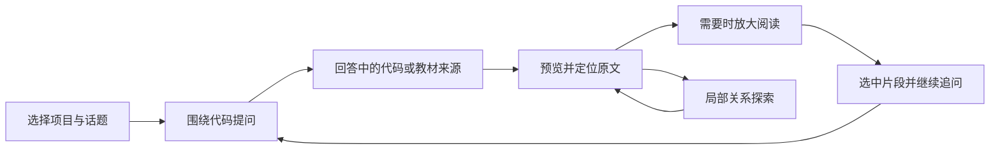

# CodeInsight 前端操作与展示成熟度调查报告

日期：2026-10-25  
调查基线：`35a3cd2`，本地主线与 `http://127.0.0.1:5173/`。  
范围：前端操作、导航、展示、状态恢复，以及直接影响操作的接口状态。**本轮没有修改应用代码。**

补充调查：[AI 工作台交互：Codex、灵活布局与材料控制](D:/yy2/CodeInsight/docs/reports/2026-10-25-ai-workbench-interactions.md)。新增官方工作台机制、空间/材料/提问范围建议和独立交互示意；下文保留第一轮问题与实测证据。

## 1. 结论

当前产品已经有可用的代码问答、教材阅读、代码证据和关系探索。它距离成熟工作台的主要差距集中在四件事：

1. **工作成果保存不足**：刷新会丢失可见对话；未发送内容也没有可靠的保存与恢复。
2. **探索来路不够完整**：右栏有自己的返回记录，但浏览器地址、刷新恢复、对话与关系图没有形成统一的探索记录。
3. **当前对象不够清楚**：用户看到的函数、右栏材料和下一次问题携带的阅读目标可能不同，界面缺少足够明确的提示。
4. **空间分配缺少任务适应性**：三栏始终固定，长文和代码没有足够自然的放大阅读入口。

前两轮改动改善了配色、排版、折叠信息和局部关系图。接下来应优先补齐保存、恢复、导航和上下文控制，再统一阅读器与交互细节。

本报告登记 **11 项改进，其中 3 项列为下一轮必须优先解决的 P0**。这里的优先级是工作安排建议，不是线上事故评级。

## 2. 调查方法与证据边界

### 本产品走查

- 使用 Edge 实际打开当前开发服务，覆盖 1440、1280、1024、900 CSS 像素宽度。
- 实际操作了导入弹窗、输入草稿、切换视图、切换项目、查看文件、教材跳转、刷新、关系探索与错误展示。
- AI 回答和上游错误使用浏览器拦截的固定 SSE 数据，明确标注“离线界面走查样例”。**没有调用真实模型，没有提交导入或重建索引。**
- 用代码检查复核状态存放位置、导航实现、阅读器和搜索反馈；用只读接口检查项目状态。
- 本次没有重跑后端/前端完整测试套件；沿用最近集成记录时明确标为历史验证。

### 对标方法

选择 GitHub、VS Code、Cursor、NotebookLM、GitBook、Obsidian 六个产品，分别对照它们擅长的操作机制。
材料来自官方文档，另实际渲染了 Cursor 和 Obsidian 的官方帮助页面。**没有在这些产品的登录账户中完成同任务对照实验。**

因此，本文是专家走查与交互机制对标，不是用户研究结果；不提供“效率提高百分之多少”或满意度分数。
官方页面的具体版本、套餐与平台支持可能不同，借鉴的是已公开的交互机制。

### 当前已经做得较好的部分

- AI 对话、代码与学习内容能在一个工作台中往返。
- 知识链接存在性经过校验，教材来源与项目证据分开。
- 事实与推断按用户偏好默认折叠，仍可查看出处和置信度。
- 局部关系图已经区分调用方向、折叠测试并保留高级全图，方向合理。
- 已有阅读滚动位置、项目内对话切换恢复、失败提示和停止生成等基础机制。

这些能力应保留，并纳入统一的状态与导航规则。

## 3. 六个成熟产品，分别借鉴什么

| 产品 | 本次核实的机制 | 对 CodeInsight 的启发 | 借鉴范围 |
|---|---|---|---|
| **GitHub 代码浏览** [S1] | 通过符号窗格查看定义、引用，连接代码位置与跨文件导航 | 文件、函数、调用处应共享清晰的位置标识和一致的阅读入口 | 代码理解与位置导航 |
| **VS Code** [S2][S3] | 布局可调整、视图可隐藏/放大、布局跨会话保存；支持面包屑、快速打开和 Peek | 三栏保留为默认布局，同时提供折叠、拖拽与临时专注阅读；少让用户丢掉来路 | 工作区布局和导航 |
| **Cursor** [S4] | 官方说明包含持久的分支对话、历史对话搜索和当前对话搜索 | 对话应当是可再次找到的工作成果；用户应能区分当前话题与其他探索 | 会话组织、历史与上下文控制 |
| **NotebookLM** [S5] | 可选择回答使用的来源；引用可预览，并跳到原文上下文 | 输入前清楚展示关联材料，回答后通过轻量引用直接核对原文 | 来源选择、引用和解释的衔接 |
| **GitBook** [S6] | 章节树、分组、页面层级与发布后的导航保持一致；建议避免过深层级 | 目录负责找位置，正文负责读内容；读长文时要有足够空间，章节要能直达 | 知识阅读结构和信息层级 |
| **Obsidian** [S7] | 局部图围绕当前笔记，支持深度调整；全局图支持过滤 | 保留当前局部阅读图；进一步让中心对象、当前材料和探索历史之间的关系明确 | 渐进探索和局部/全局切换 |

共同特征是：**位置可辨认、状态可保存、上下文可检查、操作可撤回或恢复。**
它们提供的不只是更多按钮，而是稳定的操作预期。

## 4. 实际走查结果

| 场景 | 观察结果 | 证据性质 |
|---|---|---|
| 刷新前已有一轮对话和未发草稿 | 刷新后可见对话为 0，草稿为空，右栏回到“找到的代码” | 浏览器实际复现；回答内容为离线替身 |
| 输入四行文字 | 输入区可见高度 24px，内容滚动高度 91px，没有随内容增长 | 浏览器实际测量 |
| 草稿未发送，切换到关系图再返回 | 草稿为空 | 浏览器实际复现 |
| 在项目 A 输入草稿，再切换到项目 B | 项目 A 草稿仍出现在项目 B 的输入框 | 浏览器实际复现 |
| 从回答打开 SQL 教材 | 教材成功打开，但地址仍为 `/`，没有表示当前主题或章节 | 浏览器实际复现 |
| 右栏阅读 SQL，主区域探索 `prepare_chat_stream` | 右栏仍是 SQL，回到对话后关联提示仍只写“当前阅读章节” | 浏览器实际复现；属于对象提示不足，并非所有场景都应强制自动切换 |
| 从文件树打开长文件 | 打开普通文本代码窗口，第 1–200 行；没有继续读取、任意行跳转或完整文件入口 | 浏览器实际复现及代码检查 |
| 模拟上游错误 | 有明确错误提示；没有重发/重试按钮，输入框已清空 | 浏览器实际复现；错误为测试替身 |
| 检查已失效的 `codeinsight` 项目 | 源码目录已经不存在，`GET /projects/3` 仍返回 `status: ready` | 本地文件存在性与只读接口检查 |

本次操作未发现未捕获的浏览器异常。状态丢失、范围含糊和恢复入口不足，仍会使正常流程显得不成熟。

### 三栏宽度实测

| 窗口宽度 | 文件栏 | 主区域 | 右栏 | 主区域占比 |
|---:|---:|---:|---:|---:|
| 1440 | 288 | 736 | 416 | 51.1% |
| 1280 | 288 | 576 | 416 | 45.0% |
| 1024 | 288 | 320 | 416 | 31.3% |
| 900 | 288 | 196 | 416 | 21.8% |

这些宽度下没有整页横向溢出。主任务区域仍会被两侧固定宽度挤压；“没有溢出”不足以作为阅读体验合格的判断。

## 5. 问题清单与建议

### F01 · P0 · 对话缺少刷新恢复与可找回的历史

**影响：** 用户花时间理解了一段代码，刷新后找不到这段对话，也没有历史入口。当前按项目保存的消息只在前端进程内的 Map 中。

**复现：** 发送一轮问题 → 出现回答 → 刷新页面 → 对话消失。

**建议：** 把对话做成有 ID、标题和时间的记录，至少支持刷新恢复、重新打开和新建话题。历史入口可以放在中栏标题区，保留文件树现有职责。

**依赖：** 前端保存会话标识和草稿；服务端提供可靠的历史读取/恢复。服务端目前也使用进程内会话，实施时要明确是否同时覆盖服务重启恢复。仅把一屏聊天文本写入 localStorage，不能完整解决上下文连续性。

依据：[chatStore.ts:107](D:/yy2/CodeInsight/frontend/src/store/chatStore.ts:107)、[session.py:1](D:/yy2/CodeInsight/src/codeinsight/agent/session.py:1)。参考：[S4]。

### F02 · P0 · 切换功能视图会丢草稿

**影响：** 用户写到一半，去关系图确认函数名，返回后需要重写。

**原因：** 输入值放在 InputBox 的局部 state 中，切换中栏视图会卸载 ChatWindow。

**建议：** 草稿独立于当前可见组件，按会话保存。切图、看时间线、打开教材、返回对话，都不应删除输入内容。

依据：[InputBox.tsx:16](D:/yy2/CodeInsight/frontend/src/components/chat/InputBox.tsx:16)、[CenterPanel.tsx:55](D:/yy2/CodeInsight/frontend/src/components/center/CenterPanel.tsx:55)。

### F03 · P0 · 切项目时草稿没有隔离

**影响：** 原项目的问题留在新项目输入框，容易让用户在错误范围里提交。当前消息按项目隔离，草稿却不遵循同一规则。

**建议：** 消息、会话 ID、草稿、引用目标采用一致的项目/会话归属。切换项目恢复该项目自己的草稿；输入框上方始终能看见当前项目与关联目标。

依据：[InputBox.tsx:16](D:/yy2/CodeInsight/frontend/src/components/chat/InputBox.tsx:16)、[chatStore.ts:107](D:/yy2/CodeInsight/frontend/src/store/chatStore.ts:107)。

### F04 · P1 · 应用内历史与浏览器导航脱节

**影响：** 用户能点右栏的返回按钮，却不能依赖地址栏、刷新和浏览器返回来恢复同一探索位置。从 `/` 打开的教材刷新后不会回到该章节。

**现状：** `/learn/{id}` 支持初始加载，但后续跳转主要写入内存 store，没有同步当前 URL；代码和关系图也没有等价的可恢复位置。

**建议：** 定义轻量的探索位置：项目、会话、当前阅读对象、章节/行号、图中心。应用内前后退与浏览器历史遵循同一规则。已有内存滚动恢复可以继续复用。

依据：[App.tsx:30](D:/yy2/CodeInsight/frontend/src/App.tsx:30)、[workbenchStore.ts:11](D:/yy2/CodeInsight/frontend/src/store/workbenchStore.ts:11)。参考：[S1][S3][S6]。

### F05 · P1 · 布局不能随任务调整

**影响：** 用户想专心读长文或代码时，文件树与空白对话仍占据固定空间；较窄窗口里主区域明显受挤压。

**建议：** 保留三栏默认布局，增加侧栏折叠、拖拽宽度、恢复默认，以及右栏“放大阅读”。布局按工作区保存。放大阅读期间保留原对话与阅读位置，一键返回。

**实施前的设计对齐点：** 放大后的对话以窄栏保留，还是通过一个固定入口返回。两种都可行，需要用真实长文章与长代码评审后确定。

依据：[RightPanel.tsx:61](D:/yy2/CodeInsight/frontend/src/components/evidence/RightPanel.tsx:61)、本报告宽度测量。参考：[S2]。

### F06 · P1 · 文件与符号使用两套不一致的代码阅读体验

**影响：** 点文件得到普通文本窗口；点函数得到固定 280px 高、11px 字号的 Monaco。用户的操作预期会随入口改变，长文件也缺少自然的继续阅读方式。

**建议：** 统一代码阅读器，明确区分“当前引用片段”和“完整文件”。提供行号跳转、上下窗口、突出当前引用、复制片段、选中片段后提问。

**保留约束：** 界面能继续读取代码，与模型可以接收多少代码分别控制。界面阅读扩展不应把整个文件自动塞进模型上下文。

依据：[FilePanel.tsx:70](D:/yy2/CodeInsight/frontend/src/components/evidence/FilePanel.tsx:70)、[MonacoViewer.tsx:59](D:/yy2/CodeInsight/frontend/src/components/evidence/MonacoViewer.tsx:59)。参考：[S1][S3]。

### F07 · P1 · “当前阅读内容”和“当前探索对象”缺少明确身份

**影响：** 输入框只显示“正在结合当前阅读章节提问”。用户难以判断究竟关联 SQL 的哪一节，还是刚刚在关系图中看的函数。滚动改变章节时，这段提示也没有表达出目标变化。

**建议：** 显示可检查、可移除的目标标签，例如 `SQL → 建一张表`、`chat_orchestrator.py · 1119–1140 行`。右栏明确区分“跟随当前选择”与“固定此内容”，让保留旧教材成为可理解的行为。

代码事实、教材来源与用户选中的片段继续保持不同类别；点开材料不应静默改变下一次提问的范围。

依据：[InputBox.tsx:33](D:/yy2/CodeInsight/frontend/src/components/chat/InputBox.tsx:33)、[workbenchStore.ts:11](D:/yy2/CodeInsight/frontend/src/store/workbenchStore.ts:11)、实际图/教材并排观察。参考：[S5][S7]。

### F08 · P1 · 一轮回答结束后的操作不完整

**影响：** 看完回答后缺少复制、引用片段继续问、重新发送失败问题等常用操作。出现错误时虽然有提示，但需要用户自行找回问题并再次输入。

**建议：** 增加简洁的消息操作区：复制、引用提问、失败重试。重试保留原问题、项目和阅读目标；不要在刷新页面时自动再次调用模型。

事实与推断继续默认折叠。正文旁增加轻量的来源入口，让用户不展开整块事实列表也能核对关键位置；这与用户偏好的信息密度一致。

依据：[MessageBubble.tsx](D:/yy2/CodeInsight/frontend/src/components/chat/MessageBubble.tsx)、错误走查记录。参考：[S4][S5]。

### F09 · P1 · 项目导入、状态与修复流程没有闭环

**影响：** 初次使用者需要理解绝对路径、Git ref、HEAD 和异步索引；失效项目仍可出现在选择器中。本次发现源码目录已删除的项目，接口仍报告 ready。

**建议：** 导入先突出“选择哪个本地项目”，名称与版本放入高级选项；提交前预检路径和仓库。选择器显示索引版本、更新时间及异常状态，并提供重新定位目录、刷新索引和移除记录等适当操作。

进入项目后，用现有索引提供一张简短的项目卡：主要语言、可探索入口、索引版本，以及几个可以直接点击的开始问题。先帮助用户建立“我在看什么、下一步能做什么”的认识。

**前后端边界：** 失效目录被报告为 ready 是状态判断问题，前端无法仅靠换颜色修正。修复需要接口准确表达“索引存在但源码目录不可用”。

产品说明中“契约 §3.3”这类开发信息应移回文档，界面只保留用户做选择所需的说明。

依据：[ImportProjectDialog.tsx:37](D:/yy2/CodeInsight/frontend/src/components/tree/ImportProjectDialog.tsx:37)、[projects.py:169](D:/yy2/CodeInsight/src/codeinsight/api/projects.py:169)、项目 3 的只读状态检查。

### F10 · P2 · 搜索的等待、无结果和失败不够可辨认

**影响：** 关系图的函数搜索在没有命中或请求失败时都可能只剩输入框，用户无法判断“正在找”“没找到”还是“服务失败”。文件、函数、教材分属不同搜索入口，也缺少统一的范围提示。

**建议：** 每个搜索都有明确的范围与状态：搜索中、结果数、无结果、失败重试。再补一个全局快速打开入口，按文件、函数、教材分组；专用搜索继续保留。

依据：[AdvancedGraphView.tsx:481](D:/yy2/CodeInsight/frontend/src/components/graph/AdvancedGraphView.tsx:481)。参考：[S1][S3]。

### F11 · P2 · 输入与展示细节缺少统一规格

**影响：** 四行输入仍只有单行可见高度；多处代码、路径、提示使用 10–11px 小字；工具过程直接暴露内部工具名。使用者需要不断适应不同区域的信息密度。

**建议：** 输入框随内容增高到有界高度；制定正文、代码、元数据与操作控件的字号和间距规范。工具过程采用“正在查找实现”“正在读取代码”等可理解的摘要，技术明细放入展开区。补齐键盘焦点、快捷键提示与反馈。

这是一轮展示规范化建议，不构成完整的无障碍合规评估。主题色、现有浅灰背景与天蓝强调可以继续沿用。

依据：[InputBox.tsx:48](D:/yy2/CodeInsight/frontend/src/components/chat/InputBox.tsx:48)、[MonacoViewer.tsx:85](D:/yy2/CodeInsight/frontend/src/components/evidence/MonacoViewer.tsx:85)、[MessageBubble.tsx:73](D:/yy2/CodeInsight/frontend/src/components/chat/MessageBubble.tsx:73)。

## 6. 建议形成的完整操作体验

默认仍围绕一个真实项目进行 AI 对话，学习入口由回答与右栏提供。

整条路径共同遵循三条规则：

- **同一份工作能保存**：对话、草稿与已读位置都有归属，刷新和切换功能不会让工作消失。
- **同一个对象能辨认**：项目、会话、文件/函数/章节和版本随处可检查，右栏可跟随或固定。
- **同一次探索能返回**：引用、教材与关系图共享清楚的来路，返回后恢复原来的内容与位置。

例如用户问“SQL 是什么”后，可以先读回答，再预览“表”的章节；需要时放大教材，选中 SELECT 示例并追问。
返回对话后，先前的问题、输入草稿、代码位置都仍然存在。相关项目实例通过真实出处进入源码，继续看调用关系后也能回到同一位置。

## 7. 改进顺序与验收建议

| 顺序 | 目标 | 范围 | 建议验收方式 |
|---|---|---|---|
| **第一轮：保存与恢复** | 消除工作状态丢失及范围混淆 | F01–F04，补清晰的关联目标提示 | 两轮对话加草稿，刷新、切视图、切项目后逐项核对；项目 A/B 的草稿和会话互不串用 |
| **第二轮：可持续阅读与探索** | 长文、代码和关系探索连续可用 | F05–F08 | 在 1024/1280/1440 宽度完成代码→教材→关系→回到对话；检查引用行、章节、滚动和固定/跟随状态 |
| **第三轮：完整产品流程** | 首次使用、失败恢复与操作一致性 | F09–F11 | 新项目预检、失效路径修复、无结果搜索、模拟网络/模型错误、多行输入和键盘操作 |

建议把以下条件作为下一版的验收门槛，具体视觉数值仍需设计评审：

1. 刷新后能找回同一会话及其草稿；不会自动重新提交上一条模型请求。
2. 反复切换对话、关系图、时间线，未发送内容保持不变。
3. 两个项目各有自己的草稿、会话和关联目标；提交载荷与界面所示范围一致。
4. 深链能打开指定项目中的代码位置或教材章节；应用内返回与浏览器返回行为一致。
5. 在 1024px 宽度下可以折叠侧栏，让当前主任务获得足够空间；建议将对话专注状态主区域宽度目标设为至少 600px。
6. 长文件可继续读取与跳到目标行，当前引用有明显定位；模型上下文仍遵守既有预算。
7. 失败问题一键重试，问题和关联材料不丢失；用户能看见错误原因与下一步操作。
8. 搜索中、无结果、读取失败可清楚区分；键盘能到达搜索结果与主要动作。

验收应加入当前用户实际使用的两个任务：

- **完全不懂 SQL**：从一句提问走到教材、示例、项目实例，并能返回继续问。
- **看不懂项目中的某个函数**：从回答定位源码，查看调用者与调用目标，记录理解后继续追问。

保留现有的源码/教材来源边界、事实/推断默认折叠、只读理解定位和渐进关系探索。
本轮建议没有纳入可执行练习、课程进度或自动生成个人教材等新的功能范围。

## 8. 实现依赖与取舍

| 工作 | 主要依赖 | 规模判断 |
|---|---|---|
| 草稿隔离、切视图保留、输入自增长 | 前端状态生命周期与现有组件 | 小至中 |
| 布局折叠/拖拽、阅读放大、统一代码阅读器 | 前端布局和现有代码读取接口 | 中 |
| URL 与导航恢复、固定/跟随对象 | 工作台状态模型与路由约定 | 中 |
| 对话历史、刷新/重启恢复、会话搜索 | 服务端会话/账本能力、持久化和接口契约 | 中至大，需要跨端设计 |
| 项目失效检测、修复与重建入口 | 后端状态准确性、项目管理接口和前端流程 | 中，需要跨端配合 |

这些是相对复杂度，不是工期承诺。尤其要先确认：会话保存覆盖“刷新”还是也覆盖“服务重启”，历史保留多久，以及布局放大后如何保留对话入口。

实现前应先冻结探索位置和会话恢复约定。现有会话键、代码快照、知识版本与来源校验继续使用，避免新增一套互不兼容的数据路径。

## 9. 证据与截图

本地原始记录位于 `D:/yy2/CodeInsight/.ci/frontend-audit/`，不属于应用功能代码：

- [observations.json](D:/yy2/CodeInsight/.ci/frontend-audit/observations.json)：宽度、草稿、刷新与 URL 观察。
- [file-reader.json](D:/yy2/CodeInsight/.ci/frontend-audit/file-reader.json)：文件阅读窗口与操作入口。
- [graph-error.json](D:/yy2/CodeInsight/.ci/frontend-audit/graph-error.json)：当前对象与错误恢复观察。
- [sources.json](D:/yy2/CodeInsight/.ci/frontend-audit/sources.json)：外部官方页面抓取状态及内容指纹；失效/重定向页面在下节说明。

截图：

- [首次打开](D:/yy2/CodeInsight/.ci/frontend-audit/01-home-1440.png)
- [1024px 三栏](D:/yy2/CodeInsight/.ci/frontend-audit/02-home-1024.png)
- [导入弹窗](D:/yy2/CodeInsight/.ci/frontend-audit/03-import.png)
- [回答与教材](D:/yy2/CodeInsight/.ci/frontend-audit/05-reading.png)：回答为离线替身，教材来自实际服务。
- [文件阅读](D:/yy2/CodeInsight/.ci/frontend-audit/06-file-reader.png)
- [关系图与教材并排](D:/yy2/CodeInsight/.ci/frontend-audit/07-graph-and-reading.png)
- [错误恢复状态](D:/yy2/CodeInsight/.ci/frontend-audit/08-error-fixture.png)：错误为离线替身。

上述截图反映调查基线的实际界面，**不是建议改版后的设计稿**。

## 10. 官方参考资料

均于 2026-10-25 访问。下列参考使用官方页面，不采用搜索结果中的第三方转载来证明产品行为。

- **[S1] GitHub：Navigating code on GitHub**  
  [官方文档](https://docs.github.com/en/repositories/working-with-files/using-files/navigating-code-on-github)
- **[S2] VS Code：Custom Layout**  
  [官方文档](https://code.visualstudio.com/docs/configure/custom-layout)
- **[S3] VS Code：Code Navigation**  
  [官方文档](https://code.visualstudio.com/docs/editing/editingevolved)
- **[S4] Cursor：Agent Overview**（含 Side chats 与 Conversation search）  
  [官方文档](https://cursor.com/docs/agent/overview)  
  原历史文档路径本次重定向到此页；上下文旧路径返回 404，因此没有引用失效页面。
- **[S5] Google：Use chat in Gemini Notebook**  
  [官方帮助](https://support.google.com/gemininotebook/answer/16179559?hl=en)  
  本次从 NotebookLM 官方帮助地址访问后重定向至此，页面显示 Gemini Notebook。本报告以实测页面说明引用/来源机制，不据此推断所有版本或地区的产品命名。
- **[S6] GitBook：Pages**  
  [官方文档](https://gitbook.com/docs/create-content/content-structure/page)
- **[S7] Obsidian：Graph view / Local Graph**  
  [官方帮助](https://obsidian.md/help/plugins/graph)  
  帮助站使用客户端渲染，本次通过浏览器读取正文，核实局部图、深度与过滤说明。

## 11. 调查后的建议

先交付一轮“对话和草稿不会丢、范围不会串、来路能恢复”的工作区改进，再交付布局与阅读器的统一。
这样下一次评审可以围绕完整任务验收，而不只比较单张截图的观感。
